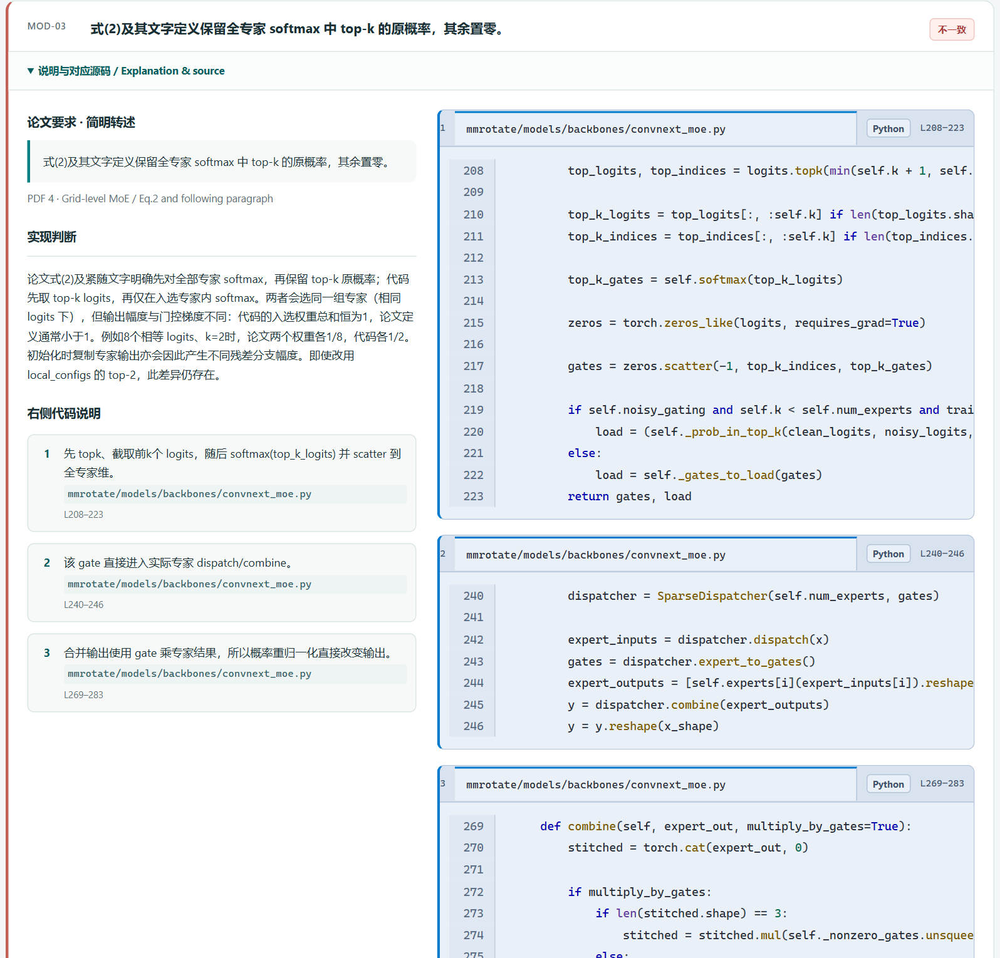
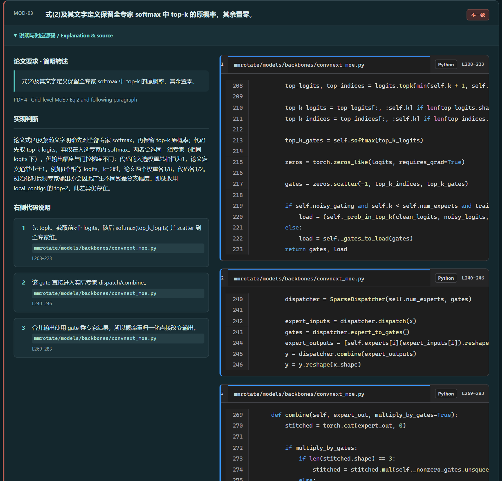

# Paper–Code Audit for Codex

**Read the paper. Trace the implementation. Inspect the evidence.**

A Codex skill that compares a research paper PDF with a local source directory or archive and builds a self-contained HTML review. It connects paper claims to the **active implementation**, with source references, a transparent consistency score, and clear evidence limits.

**论文 PDF + 代码目录／压缩包 → 可视化一致性审查报告。** 从真实调用链核对方法、公式、损失与实验配置，左侧读解释，右侧看源码。

**Codex Skill · Python 3.10+ · Offline HTML · Light / Dark · MIT**

## Screenshots · 真实示例

The screenshots below come from a user-supplied **SM3Det** audit dated November 18, 2026. Scores and judgments apply to that selected code snapshot/configuration: **static audit records, not tool accuracy or reproduced benchmark results**.

以下均为真实报告的界面截图，仅裁剪展示范围；报告分数、文字和源码未作修改。截图未包含本机绝对路径与来源信息页。

### 1. Overview · 先看结论与证据范围

[](docs/images/sm3det-overview.png)

*示例报告显示：58.96% 静态一致性、83.75% 加权证据覆盖率；未执行训练或检测评估。点击图片可放大。*

### 2. Evidence · 左侧说明，右侧源码

Each requirement has a verdict, a concise paper paraphrase, and an implementation explanation. Numbered mappings lead to real source excerpts with filenames, line numbers, and VS Code-like syntax colors.

The cropped example below is the report's `MOD-03` item, which examines the execution order of `top-k` and `softmax`. This is an example of how an implementation difference is documented for the selected snapshot.

[](docs/images/sm3det-evidence-light.png)

*同一条检查项将论文要求、判定依据与对应源码放在一起；源码可横向滚动，报告中的映射支持跳转。*

<details>
<summary><strong>Dark theme · 查看同一条证据的深色主题</strong></summary>

The upper-right theme switch remembers the reader's choice. Both themes keep source panels distinct from explanatory text; narrow screens stack the two columns.

[](docs/images/sm3det-evidence-dark.png)

</details>

## What you get · 功能

- **Method-to-code mapping:** follow configuration inheritance, model construction, forward, losses, and prediction paths. Distinguish active code from unused or alternate implementations.
- **A readable report:** the paper's main network figure as a verified crop, side-by-side explanation and source, searchable requirements, and expandable evidence.
- **Offline source highlighting:** Python and common configuration/code formats use multiple syntax colors without a CDN or extra highlighting package. Original source characters remain unchanged.
- **A reviewable score:** fixed category weights, separate evidence coverage, explicit unknowns, and critical unresolved items beside the headline.
- **Traceable artifacts:** retain the checklist, evidence JSON, file hashes, and score data behind the HTML.

## Quick start · 快速开始

### 1. Download

```bash
git clone https://github.com/PolarisFTL/paper-code-audit-skill.git
cd paper-code-audit-skill
```

You can also download the repository ZIP from GitHub and open its extracted directory.

### 2. Install the skill

Copy `skills/paper-code-audit` into your Codex skills directory. These commands are for a first installation; inspect or back up an existing skill with the same name before replacing it.

**macOS / Linux**

```bash
mkdir -p ~/.codex/skills
cp -R skills/paper-code-audit ~/.codex/skills/
```

**Windows PowerShell**

```powershell
New-Item -ItemType Directory -Force "$env:USERPROFILE/.codex/skills" | Out-Null
Copy-Item -Recurse ./skills/paper-code-audit "$env:USERPROFILE/.codex/skills/"
```

### 3. Give Codex the two inputs

```text
Use $paper-code-audit.
Paper PDF: /path/to/paper.pdf
Code directory or archive: /path/to/source.zip
Output: /path/to/new-audit-directory

Compare the paper's method and reported setup with the active implementation.
Create an HTML report with the main network figure, side-by-side source evidence,
and a transparent consistency score. Do not train or change the original files.
```

<details>
<summary><strong>中文调用示例</strong></summary>

```text
使用 $paper-code-audit。
论文：D:/papers/paper.pdf
代码：D:/downloads/source.zip（也可以是源码目录）
输出：D:/reports/new-paper-audit

请核对论文方法和真实代码，生成带主网络图、左右源码对照、语法高亮和
一致性评分的 HTML 报告。保留原始文件，不启动训练。
```

</details>

**Supported inputs:** a PDF plus a source directory, ZIP, TAR, TAR.GZ/TGZ, TAR.BZ2, or TAR.XZ. For RAR/7z, provide an extracted directory or a supported archive. Use a **new** output directory for each audit.

## How the score works · 如何理解百分比

The score measures the paper requirements supported by the available implementation evidence. It is a static review rubric, not a calibrated reproduction predictor.

| Displayed consistency score | Report label |
|---|---|
| Greater than 80% | 可复现性强 / Strong reproducibility potential |
| 50%–80%, inclusive | 中等 / Moderate reproducibility potential |
| Below 50% | 可能无法正常复现 / May not reproduce as expected |

- Six category weights: **architecture 25%, core modules 25%, objectives/gradients 15%, training 15%, data 10%, evaluation 10%**.
- Matched = 1; partial = 0.5; mismatch or unknown = 0. Unknowns stay in the denominator; justified inapplicable requirements are excluded.
- Evidence coverage uses the same category weights. It is reported separately from consistency; its value is not simply the ratio of assessed items to all items.
- A paper-derived checklist is frozen before source review. Retrospective scoring is visibly marked.
- Missing evidence can lower the score without proving an implementation is wrong. Actual loading, training, and benchmark reproduction require their own evidence.

See the [full scoring rubric](skills/paper-code-audit/references/scoring.md).

## Outputs and boundaries · 输出与范围

```text
new-audit-directory/
├── report.html                 # Self-contained, readable offline
├── report.score.json           # Computed scores and category breakdown
├── audit.json                  # Requirements, judgments and source references
├── plan.json                   # Frozen checklist, when applicable
├── inputs.json                 # Input provenance
└── source_manifest.json        # Source inventory and hashes
```

Codex performs the semantic audit. The Python helpers prepare inputs, validate references and hashes, calculate scores, and render the HTML; the renderer alone does not understand a paper automatically.

Python **3.10+** runs the helpers. Existing `pdftotext`, `pypdf`, or Codex PDF tools are used to read the paper. The skill does not automatically install dependencies, execute project code, train a model, download weights, or publish audit materials. Original papers and source files stay read-only.

For direct helper usage and report fields, see the [audit JSON contract](skills/paper-code-audit/references/audit-schema.md) and [skill instructions](skills/paper-code-audit/SKILL.md).

## Development

```bash
python -m unittest discover -s tests -v
```

## License and example attribution

This skill is released under the [MIT License](LICENSE). The SM3Det screenshots are cropped views of the supplied audit report, included to demonstrate the interface. This repository does not bundle the complete report, paper, source snapshot, dataset, or checkpoints. Underlying papers and code retain their original rights and licenses.
